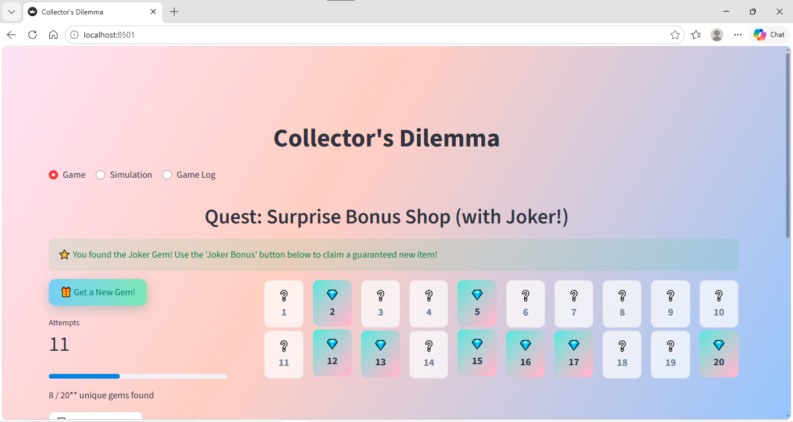
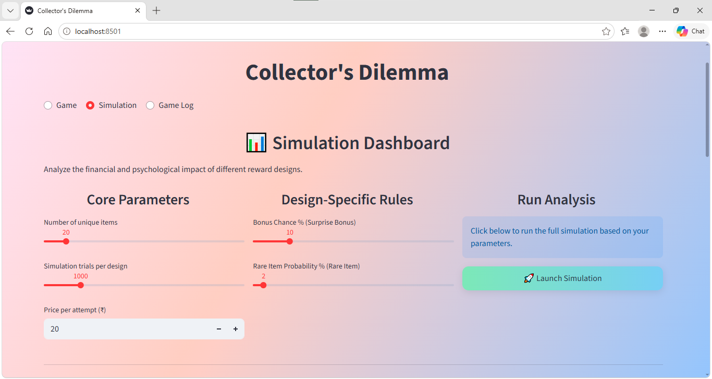

# The Collector's Dilemma

A small game + simulation dashboard I built for my Probability course in the first semester of my MSc. It's based on the Coupon Collector's Problem: if every purchase gives you one random item out of n, how many purchases does it take to collect the full set?

I wanted to make the math something you could actually play with, and then use simulation to see what it means for a business running a "collect them all" campaign (sticker albums, gacha games, loyalty cards, that kind of thing).



## The idea

You collect 20 gems, one random draw at a time. There are three shops, each with a different reward rule:

- **Equal Chance Mart** – every gem is equally likely.
- **Rare Item Trove** – one gem only shows up 2% of the time.
- **Surprise Bonus Shop** – each draw has a 10% chance of a free extra gem, and there's a Joker gem that gives you a guaranteed new one.

Playing it a few times makes the problem obvious. The first gems come quickly and the last two or three take forever, mostly because you keep getting duplicates.

## The math behind it

For the equal-chance case the expected number of draws has a closed form:

$$E[T] = n \cdot H_n = n\left(1 + \frac{1}{2} + \frac{1}{3} + \dots + \frac{1}{n}\right)$$

For n = 20 that works out to about 72 draws, which is a lot more than most people guess.

The other two designs don't have a simple formula, so I used Monte Carlo simulation. To check the simulation was right, I ran it on the equal-chance case first and compared the average against n·H_n. They match closely, so I trusted it for the other two.

## Simulation dashboard



In the Simulation tab you can change the number of items, the number of trials, the price per draw, the bonus chance and the rare-item probability, then run all three designs side by side. It shows:

- average cost to finish a collection for each design
- simulated mean vs. the theoretical value (as a sanity check)
- box plots and violin plots of the number of attempts, to show the spread and not just the average
- a short write-up of what each design is good for

There's also a Game Log tab that records finished games and lets you download them as a CSV.

## What I found

- The rare-item design costs the most by far, and its distribution has a long right tail. Most players finish somewhere reasonable, but a few unlucky ones end up spending a huge amount. That's where the money comes from, and also where the frustration comes from.
- The surprise-bonus design is the cheapest and the most consistent. The bonus works like a safety net against long bad-luck streaks.
- Equal chance is the easiest to explain and lines up with the formula.

Basically, how you design the randomness decides who pays and how annoyed they get, and you can test that with a simulation before launching anything.

## Running it locally

You'll need Python 3.9 or newer.

```bash
git clone https://github.com/<your-username>/collectors-dilemma.git
cd collectors-dilemma
pip install -r requirements.txt
streamlit run app.py
```

It should open at http://localhost:8501.

## Files

```
app.py              the Streamlit app (game, simulation, game log)
requirements.txt    packages needed
images/             screenshots used in this README
presentation/       slides I presented for the course
```

## Built with

Python, Streamlit, pandas, NumPy and Plotly.

## If I worked on it again

I'd add some player behaviour to the simulation, like a "pity" rule (a guaranteed rare item after a certain number of misses) and a point where players give up. That would show not just how much a design earns, but how many people it loses along the way.
